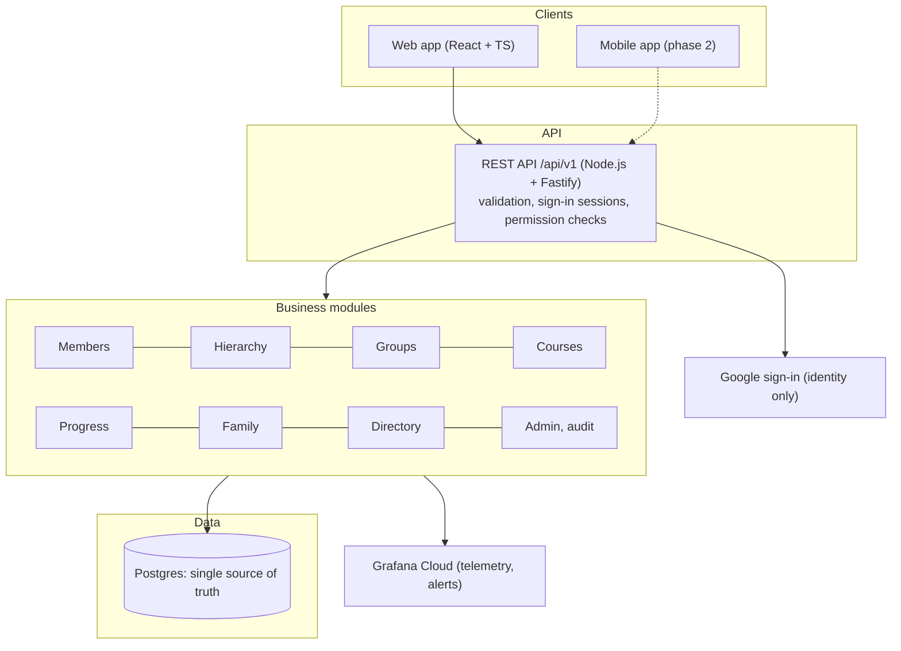
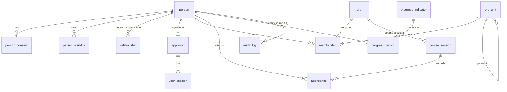
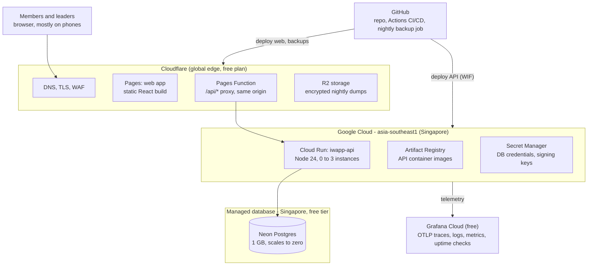

# IWApp MVP Technical Specification

ISKCON Whitefield Congregation App · 2026-11-07 · Prepared for Suresh Balasubramanian · Status: Baseline for the MVP build (open questions Q1–Q6 still to be answered)  
> The shared Claude doc is the master copy; this file is the snapshot Claude Code builds from.

## 1. Summary and decisions for approval

IWApp's MVP is a responsive React + TypeScript web app on a Node.js (Fastify) API, with **one database: Postgres**. Expected running cost is **about ₹0 a month**, plus around ₹1,000 a year for a domain. It runs on free tiers: Cloudflare Pages, Google Cloud Run, Neon Postgres and Grafana Cloud. GitHub Actions builds, tests and deploys every change.

The build can start once these decisions are approved:

| \#  | Decision               | Recommendation                                                                                                                                                      | Main alternative                                                                             |
|-----|------------------------|---------------------------------------------------------------------------------------------------------------------------------------------------------------------|----------------------------------------------------------------------------------------------|
| D1  | Database               | One database: Postgres. Hierarchy, family and course questions use joins and recursive queries. Neo4j is deferred to a later phase, if needed.                      | Postgres plus a Neo4j graph copy (earlier draft), or Neo4j only                              |
| D2  | Sign-in                | Google sign-in only. An admin invites each user by email and links them to a member profile.                                                                        | Phone OTP in a later phase; the temple pays per SMS sent (rate to be quoted by the provider) |
| D3  | Hosting                | Free tiers across providers, all in or near the Singapore region (section 8)                                                                                        | One Oracle Cloud Always Free VM running everything in Docker                                 |
| D4  | Repository             | One monorepo `iwapp` (pnpm + Turborepo) with web, api and shared packages; private GitHub repo                                                                      | Separate repos per app                                                                       |
| D5  | Who can see what       | Admins see everything. Leaders see their own unit and everything under it. Members see their own profile and family. Field-level visibility follows member consent. | Leaders see the whole directory                                                              |
| D6  | Gita course engagement | Per-session attendance. Each participant's enrolment shows sessions attended, first and last attended, and status.                                                  | Total count entered manually                                                                 |
| D7  | Test data              | A deterministic synthetic data generator for local, CI and staging. A CSV import for real data in milestone M4.                                                     | Hand-entered test data                                                                       |

## 2. PRD review

The PRD's data model and MVP list are clear enough to build. Your answers on 7 Nov settled four gaps. The rest are working assumptions you can overturn at review.

**Settled with you**

- **Sign-in:** Google sign-in only. With SMS OTP, every message is billed to the app owner, so OTP is deferred.

- **Existing data:** None confirmed yet. The MVP ships with realistic synthetic data and a CSV import for when real data arrives.

- **Gita course:** Per-session attendance. Facilitators mark each session, and the app works out the engagement level.

- **Hosting:** The cheapest option across any providers.

**Assumptions (correct any that are wrong)**

- **A1.** Up to about 10,000 profiles and under 50 concurrent admin and leader users.

- **A2.** ISKCON Whitefield only, so one temple and no multi-tenancy.

- **A3.** English UI. Names and fields accept any script.

- **A4.** Members without a Google account still have profiles; they just don't sign in.

- **A5.** Members see only their own profile and family in the MVP. There is no member-facing directory, per PRD §3.

- **A6.** Spiritual progress is recorded periodically (for example monthly) by the member or their leader.

- **A7.** Age is calculated from date of birth. Where only an approximate age is known, the birth year is stored.

- **A8.** Leaders mostly use the app on their phones, so every screen is mobile-first.

**Open questions for review**

- **Q1.** Does “Number of Bhakti Steps conducted” mean sessions a leader has run, or the step level a member has reached (for example Shraddhavan, Krishna Sevaka)? The spec makes progress indicators configurable either way.

- **Q2.** Should a member's leader be able to edit that member's contact details, or only their spiritual progress and memberships?

- **Q3.** Can a person be in more than one Bhakti Vriksha at a time? The default assumes one active BV, with any number of other groups.

- **Q4.** Which domain will the app use, for example `app.iskconwhitefield.org`, and who manages its DNS?

- **Q5.** Is there a named data-protection contact at the temple? The privacy notice must name one.

- **Q6.** Who will be the first two administrators?

## 3. MVP scope

The MVP covers all nine items in PRD §5 through eight modules. Donations, the mobile app, phone OTP and member-facing directory search are out of scope.

| Module                    | What the MVP delivers                                                                                                                                                                                                                                                                                              | PRD           |
|---------------------------|--------------------------------------------------------------------------------------------------------------------------------------------------------------------------------------------------------------------------------------------------------------------------------------------------------------------|---------------|
| Members                   | Create, view, edit and archive profiles. Fields: legal name, initiated name, gender, DOB or birth year, hometown, current locality, workplace, year first connected to Krishna consciousness, phone, email, WhatsApp, notes. Duplicate check by phone, email and fuzzy name before saving. One profile per person. | 2.1, 5.1, 5.6 |
| Hierarchy                 | Sector → Circle → Bhakti Vriksha tree. Create, rename, move and archive units. Assign a leader and co-leaders at each level. Drill down from sector to members, and roll up counts.                                                                                                                                | 2.3, 5.3      |
| Groups and initiatives    | Groups typed as Service, Initiative, Yatra, Harinama or Course. Each group has an owner and optional co-owners. Members join with a role and a start date. Leaving sets an end date, so history and duration are kept.                                                                                             | 2.2, 5.2      |
| Courses and attendance    | A course is a group with numbered sessions. Facilitators mark attendance per session on a phone-friendly grid. Each participant's enrolment shows sessions attended out of the total, first and last dates, and status (enrolled, active, completed, dropped). Participants can be searched by sessions attended.  | 5.8, 5.9      |
| Spiritual progress        | Admin-configurable indicators, seeded with: daily chanting rounds, Bhakti Steps (Q1), BV tenure (derived) and the four regulative principles (optional). Each value is recorded with an as-of date, giving a history per member.                                                                                   | 2.3, 5.4      |
| Family                    | Spouse, parent/child, sibling and “other” (with a label) links between existing profiles. Inverse links are created automatically, with no duplicate profiles. A family panel shows on the profile, with a small family-graph view.                                                                                | 2.4, 5.5      |
| Directory and views       | Search by name, phone or email, with typo tolerance. Filter by unit, group, leader, locality, course engagement and progress. Save filters. Export to CSV (admins only, and logged). The profile page shows family, memberships, leaders and progress in one place.                                                | 2.5, 6        |
| Access and administration | Google sign-in. Roles: Admin, Leader (scoped) and Member. Users are invited by email. Consent capture, field visibility and an audit log of every change to personal data. CSV import of members and memberships, with a dry-run preview (M4).                                                                     | 3, 4, 5.7     |

**Key user journeys the tests must cover**

1.  An admin builds the hierarchy, creates a BV and appoints its leader.

2.  A leader signs in on a phone and sees only their BV's members. They update a member's chanting rounds.

3.  A facilitator creates Gita Course 2026 with 12 sessions, marks attendance for session 3, then searches for participants who attended at least 8 sessions.

4.  An admin adds a member. The app warns of a likely duplicate, and the admin links that person as a spouse instead.

5.  A member signs in and corrects their own phone number. They see their family and memberships but no one else's contact details.

6.  A member withdraws consent. Their optional fields are hidden from leaders, and the change is audit-logged.

## 4. Logical architecture

IWApp has four layers: clients, one REST API, the business modules inside it, and a single Postgres database. The backend is one Node.js service, a modular monolith. Every release is one deployment, and every change is saved in one database transaction.

Requests flow top to bottom. Google handles sign-in only, and every layer reports to Grafana Cloud.

**Components**

- **Web app:** React 19, TypeScript, Vite, Mantine UI, TanStack Router and Query, React Hook Form with Zod, and the Grafana Faro SDK. It is mobile-first and talks only to `/api/v1` on its own origin.

- **Edge proxy:** a Cloudflare Pages Function forwards `/api/*` to the API. The app and the API share one origin, so session cookies stay first-party and no CORS is needed.

- **REST API:** Fastify on Node 24 LTS. Before any module runs, each request is validated with Zod, its sign-in session is checked, and one `authorize(actor, action, resource)` policy decides whether it is allowed. OpenAPI is generated from the same schemas.

- **Business modules:** members, hierarchy, groups, courses, progress, family, directory, import, audit, admin. Each module has its own routes, service and repository. Lint rules stop modules from reaching into each other's internals, so any module can be split out later.

- **Database:** Postgres, accessed through Drizzle ORM. Row-level security can enforce leader scopes inside the database too, as a second line of defence.

- **Shared package:** Zod schemas, API types and a generated client, reused by the mobile app in phase 2.

**How relationship questions are answered in Postgres**

| Question                                   | How                                                                                | Example                                                                                                        |
|--------------------------------------------|------------------------------------------------------------------------------------|----------------------------------------------------------------------------------------------------------------|
| Everyone under a sector or circle          | A recursive query over `org_unit` (three levels)                                   | All members under Sector 2, grouped by circle                                                                  |
| A member's family                          | A join on `relationship` in both directions, plus a second hop for extended family | Spouse, parents, children and siblings on the profile                                                          |
| Filters that combine several relationships | Joins with `EXISTS` and `NOT EXISTS`                                               | Gita Course 2026 participants with 8 or more sessions who are not yet in any Bhakti Vriksha (a follow-up list) |
| Name, phone and email search               | `pg_trgm` and full-text search                                                     | “Radhika” also finds “Radika”                                                                                  |
| A leader's scope                           | A recursive query, cached for each request                                         | Is this member under a unit this leader leads?                                                                 |

At 10,000 members, each of these takes milliseconds with ordinary indexes.

**Why one database (D1).** The MVP's relationship questions are shallow: a three-level hierarchy, family one or two hops away, and direct course enrolment. Most of the data is records (profiles, consent, audit, attendance, progress history), which is Postgres's strength. One database means one place to back up, secure and erase personal data, and no code to keep two stores in sync. Neon Free wakes automatically on the next query and can restore the last 6 hours. AuraDB Free pauses after three idle days and keeps one manual backup ([Neo4j quotas](https://neo4j.com/docs/aura/quotas-and-limits/)).

**When to add Neo4j.** A later phase may need deep, open-ended graph questions: how two people are connected, recommendations based on relationships, or network analysis. Neo4j can be added then as a read-only copy, fed from Postgres. `membership` and `relationship` are already stored as link tables, so nothing needs redesigning.

## 5. Data model

All data lives in 14 Postgres tables, covering people, structure, engagement, access and audit. All IDs are UUIDv7. Every row has `created_at/by` and `updated_at/by` columns, and a `version` column for optimistic locking.

**Postgres tables**

Person sits at the centre. Membership ties a person to a hierarchy unit or a group, with start and end dates. Attendance and progress records add history without overwriting it.

| Table                | Key columns                                                                                                                                                                          | Rules                                                                                                                                                            |
|----------------------|--------------------------------------------------------------------------------------------------------------------------------------------------------------------------------------|------------------------------------------------------------------------------------------------------------------------------------------------------------------|
| `person`             | legal_name, initiated_name, display_name, gender, dob, birth_year, hometown, locality, workplace, kc_since_year, phone_e164, email, whatsapp_e164, notes, status, guardian_person_id | Phone numbers normalised to E.164. Status is active, inactive, moved, deceased or archived. A trigram index on the names supports fuzzy search.                  |
| `person_consent`     | person_id, notice_version, method, granted_at, recorded_by, withdrawn_at                                                                                                             | Method is self (online), paper form or recorded by a leader. Under-18s need a guardian's consent.                                                                |
| `person_visibility`  | person_id, field_group, level                                                                                                                                                        | Field groups: contact, personal, work, spiritual. Levels: private, leaders, admins. Default: leaders.                                                            |
| `org_unit`           | kind, parent_id, name, locality, meeting_day, active                                                                                                                                 | The kind is sector, circle or bhakti_vriksha. A check enforces the parent's kind (a circle sits under a sector, a BV under a circle).                            |
| `grp`                | kind, name, description, starts_on, ends_on, active                                                                                                                                  | The kind is service, initiative, yatra, harinama, course or other.                                                                                               |
| `membership`         | person_id, unit_id or group_id (exactly one), role, start_date, end_date, end_reason                                                                                                 | Roles: member, leader, co_leader, owner, facilitator. Leaving sets end_date, so history is never deleted. One active BV per person (Q3).                         |
| `course_session`     | group_id, seq_no, held_on, topic                                                                                                                                                     | Allowed only for groups of kind course.                                                                                                                          |
| `attendance`         | session_id, person_id, status, marked_by, marked_at                                                                                                                                  | Status is present, absent or excused. One row per person per session. A view gives each participant's sessions attended, first and last dates, and engagement %. |
| `progress_indicator` | key, label, value_type, unit, active                                                                                                                                                 | Configured by an admin and seeded for Q1.                                                                                                                        |
| `progress_record`    | person_id, indicator_id, value, as_of, recorded_by                                                                                                                                   | Append-only history. The latest value is a view.                                                                                                                 |
| `relationship`       | person_a, person_b, kind, label                                                                                                                                                      | Kind is spouse, parent_of, sibling or other. Unique on (a, b, kind), and a person can't be linked to themselves. Inverse links are derived, not stored.          |
| `app_user`           | person_id, google_sub, email, is_admin, status, last_login_at                                                                                                                        | Status is invited, active or disabled. Each user links to one person.                                                                                            |
| `user_session`       | user_id, refresh_hash, expires_at, revoked_at                                                                                                                                        | Refresh tokens rotate, and only their hashes are stored.                                                                                                         |
| `audit_log`          | at, actor_id, action, entity, entity_id, changes, request_id                                                                                                                         | Append-only and readable only by admins. Stores the names of changed fields, plus old and new values.                                                            |

The CSV import adds an `import_job` table holding the dry-run report and the result.

**Size check:** 10,000 members with a year of attendance and progress history should stay under 150 MB, well inside Neon Free's 1 GB ([Neon](https://neon.com/faqs/free-plan-limits-and-quotas)). The free-tier headroom alert (section 9) warns at 70%.

## 6. Security, privacy and access control

Access is denied unless a rule allows it. Each rule combines a role, a scope and the member's field-visibility choice, and one policy module enforces every rule. The design follows India's DPDP Act 2023. Its main obligations (notice, consent, security safeguards, breach notification, data-subject rights) take effect on 13 May 2027 ([Mondaq](https://www.mondaq.com/dpdp-act-and-rules-2025-the-2026-compliance-milestones-businesses-cant-afford-to-miss/1830402)). Building them in now avoids a retrofit later.

**Authentication**

- Sign-in uses Google Identity Services. The API verifies the Google ID token (audience, issuer, expiry), matches the verified email to an invited `app_user`, and stores the Google `sub` for later logins.

- A Google account that hasn't been invited gets “Ask an admin to invite you”. No account is created automatically.

- After sign-in, the API issues its own session: a 15-minute access JWT and a rotating 14-day refresh token. Both are `HttpOnly`, `Secure`, `SameSite=Strict` cookies, with a CSRF double-submit token on writes.

- Signing out, or an admin disabling a user, revokes all of that user's sessions.

**Permissions**

| Capability                                       | Admin                               | Leader (own scope)                                                   | Member (self)                      |
|--------------------------------------------------|-------------------------------------|----------------------------------------------------------------------|------------------------------------|
| View member list and profiles                    | All                                 | Members of the units and groups they lead, and every unit below them | Own profile and immediate family   |
| See contact and personal fields                  | Yes (unless the member set private) | If the member's visibility is “leaders”                              | Own                                |
| Create a member                                  | Yes                                 | Yes, auto-added to the leader's unit                                 | No                                 |
| Edit profile fields                              | Yes                                 | Progress and memberships; contact details per Q2                     | Own contact and personal fields    |
| Manage hierarchy and groups                      | Yes                                 | Groups they own (add or remove members, sessions, attendance)        | No                                 |
| Record progress and attendance                   | Yes                                 | In scope                                                             | Own progress (if enabled)          |
| Family links                                     | Yes                                 | In scope                                                             | Request a link (an admin approves) |
| Export CSV, import, view audit log, manage users | Yes                                 | No                                                                   | No                                 |

A leader's scope is every unit they lead, with all units below it, plus every group they own. Scope is worked out in Postgres on each request and cached for the length of that request.

**Privacy and consent**

- **Notice and consent:** a short privacy notice (versioned) is shown at sign-in, and on a printable form for members who don't sign in. Each consent is recorded with the method, the person who recorded it and the date. Withdrawing consent hides the optional fields at once and flags the profile for review.

- **Data minimisation:** only name and locality are required. Every other field is optional. Logs never hold contact details, DOB or notes.

- **Minors:** a profile for anyone under 18 needs a linked guardian and the guardian's consent. Minors' contact fields are visible to admins only.

- **Member rights:** members can see and correct their own data. Erasure anonymises the person row, removes their family links and keeps an audit record that a request was carried out.

- **Audit:** every create, update, delete, export and import on personal data is logged with actor, time, request ID and changed fields.

**Application and platform security**

- All input is validated with Zod at the API edge. All queries are parameterised through Drizzle.

- The app runs over HTTPS only, with HSTS, a strict Content Security Policy, the Helmet security headers and rate limits (sign-in 10 per minute per IP; API 300 per minute per user).

- Secrets live in Google Secret Manager. Each database has a separate least-privilege user for the app and for migrations.

- GitHub Actions deploys through Workload Identity Federation, so no long-lived cloud keys exist. Branch protection and required reviews are on.

- Backups are encrypted with `age` before they leave the pipeline (section 8).

- Dependabot and `npm audit` run in CI, along with secret scanning and CodeQL. CodeQL is free on public repos; for a private repo it needs GitHub's nonprofit plan or paid code scanning.

## 7. API and frontend design

The API is a versioned REST API, `/api/v1`, described by OpenAPI 3.1 generated from the Zod schemas. The same contract serves the web app now and the mobile app in phase 2.

**API conventions**

- **Resources:** `/members`, `/members/{id}/family`, `/members/{id}/memberships`, `/members/{id}/progress`, `/units` (tree, with `?include=counts`), `/units/{id}/members?depth=all`, `/groups`, `/groups/{id}/members`, `/courses/{id}/sessions`, `/sessions/{id}/attendance` (bulk PUT), `/directory/search`, `/imports`, `/audit`, `/users`, `/auth/google`, `/auth/refresh`, `/auth/logout`, `/me`.

- **Lists:** cursor pagination (`?cursor=&limit=`, max 100), plus `?sort=` and typed filters (`unitId`, `groupId`, `leaderId`, `locality`, `minSessions`, `indicator`, `status`).

- **Concurrency and retries:** writes need an `If-Match` version header, so two leaders can't silently overwrite each other's edits. A retried POST carries an `Idempotency-Key` header, so mobile retries never create duplicate records.

- **Errors:** RFC 9457 problem+json responses with a stable `code` and the request ID.

- **Operations:** `/healthz` (liveness) and `/readyz` (checks Postgres).

**Frontend**

- **Screens:**

  - Sign-in

  - Dashboard: counts by sector, recent changes, follow-up lists

  - Directory: search and filters

  - Member profile: tabs for details, family, memberships, progress and history

  - Member form, with the duplicate warning

  - Hierarchy explorer: tree, drill-down and roll-up counts

  - Groups: list and detail

  - Course: sessions and attendance grid

  - Family graph view (Cytoscape.js)

  - Admin: users, indicators, import, audit, consent

- **Mobile first:** layouts are designed for a 360 px width first. The attendance grid works by tapping, with large hit targets. Lists are virtualised for 10,000 rows.

- **Code and state:**

  - The structure is feature-based (`features/members`, `features/courses` and so on). Server state lives in TanStack Query; there is no global store.

  - Forms use React Hook Form with the shared Zod schemas, so validation rules match the API.

  - Navigation is permission-aware: menus and buttons come from the `/me` capabilities. The API still enforces every rule on its own.

- **Quality bar:** WCAG 2.1 AA (axe checks in CI), Core Web Vitals in Faro, and an initial JS bundle under 250 KB gzipped, with routes code-split.

- **Look and feel:** a calm devotional palette with saffron accents. The temple can supply its logo and colours.

## 8. Physical architecture and hosting

Everything runs on free tiers, and expected use stays far below each limit. Only the domain has a fixed cost. All runtime pieces sit in or near the Singapore region, which keeps database round trips under 5 ms. Users in Bengaluru reach Singapore in roughly 40–60 ms.

Browsers reach Cloudflare only. The Pages Function forwards API calls to Cloud Run, which is the only component that talks to the database.

| Component                    | Service and region                                                                          | Free allowance                                                                                                                                           | Expected MVP use                            | Cost                |
|------------------------------|---------------------------------------------------------------------------------------------|----------------------------------------------------------------------------------------------------------------------------------------------------------|---------------------------------------------|---------------------|
| Web app, CDN, TLS, DNS, WAF  | Cloudflare Pages (global edge)                                                              | Static assets unlimited; 100,000 Function requests/day ([Cloudflare](https://developers.cloudflare.com/workers/platform/pricing/index.md))               | Under 5,000 API requests a day              | ₹0                  |
| API                          | Google Cloud Run, asia-southeast1. 1 vCPU, 512 MiB, 0 to 3 instances, request-based billing | 180,000 vCPU-s, 360,000 GiB-s and 2M requests a month ([Cloud Run pricing](https://cloud.google.com/run/pricing))                                        | Under 15,000 vCPU-s a month                 | ₹0                  |
| Container images and secrets | Artifact Registry, Secret Manager                                                           | Small free quotas                                                                                                                                        | Keep the last 5 images; about 5 secrets     | ₹0 to about ₹20     |
| Database                     | Neon Postgres Free, AWS ap-southeast-1 (Singapore)                                          | 1 GB storage, 100 CU-hours a month, scales to zero after 5 min idle ([Neon](https://neon.com/faqs/free-plan-limits-and-quotas))                          | Under 150 MB                                | ₹0                  |
| Backups                      | Nightly GitHub Action: `pg_dump`, encrypted with `age`, stored in Cloudflare R2             | R2 free storage tier                                                                                                                                     | Under 1 GB (30 daily and 12 monthly copies) | ₹0                  |
| Observability                | Grafana Cloud Free                                                                          | 10,000 metric series; 50 GB each of logs and traces; 14-day retention ([summary](https://costbench.com/software/observability/grafana-cloud/free-plan/)) | Under 2 GB of logs a month                  | ₹0                  |
| CI/CD                        | GitHub Actions                                                                              | Free minutes on GitHub Free; more on the nonprofit Team plan                                                                                             | About 1,500 minutes a month                 | ₹0                  |
| Domain                       | Any registrar, DNS on Cloudflare                                                            | none                                                                                                                                                     | 1 domain                                    | About ₹1,000 a year |

**Free-tier risks and how the design handles them**

- **Cold starts:** Cloud Run and Neon both scale to zero. The first request after an idle spell can take 2–4 s. If that bothers leaders, keep one Cloud Run instance warm. At Cloud Run's idle rates that costs about US\$9–10 a month (about ₹800), our arithmetic from the [published rates](https://cloud.google.com/run/pricing).

- **Short Neon restore window:** Neon Free can only restore the last 6 hours. Nightly encrypted dumps, with a quarterly restore drill, cover longer periods.

- **Region choice:** Singapore is the assumed Neon region. Confirm it when the account is created. If Neon offers Mumbai, use that and move Cloud Run to asia-south1 to match.

- **Google Cloud billing account:** it needs a card. A budget alert at ₹200 a month emails the admins.

**Alternative (D3): one Oracle Cloud Always Free VM.** It runs Postgres and the API in Docker Compose, hosted in India. The cost is the same (₹0), and it avoids cold starts. We would have to patch the operating system, run backups and accept that Oracle can reclaim idle free VMs. That is more operational load than a volunteer team should carry, so I recommend the managed free tiers above.

If the app outgrows the free tiers, moving to Neon's paid plan is a configuration change, with no code changes.

## 9. Observability

OpenTelemetry is built in from the first commit. Every request can be followed from a browser click through the API and into each database query, using one trace ID. Logs, metrics and traces all go to Grafana Cloud, with dashboards and alerts kept as code in the repo.

**Signals**

- **Traces:** the OpenTelemetry Node SDK auto-instruments HTTP, Fastify and `pg`, so every database query shows up as a span. The browser starts the trace (Faro, using W3C `traceparent`), so one trace covers screen to database. All traces are sampled at this volume.

- **Logs:** Pino writes structured JSON logs. Each line carries `trace_id`, `span_id`, `request_id`, `user_id` and `route`. Redaction rules strip phone, email, DOB, notes and tokens. Logs go to stdout, where Cloud Logging is the fallback, and are also exported over OTLP to Grafana Loki.

- **Metrics:**

  - Per-route request rate, errors and latency

  - Database pool, query latency and storage used

  - Cold starts

  - Sign-in success and failure counts

  - Business gauges: active members, members per sector, attendance marked this week, profiles without consent

- **Frontend:** Grafana Faro captures JavaScript errors, Core Web Vitals, route timings and failed API calls.

- **Audit trail:** the `audit_log` table answers who changed what. It is a business record, separate from operational logs.

**Service levels and alerts**

| Signal                                                                   | Target                                 | Alert when                                              | Sent to                               |
|--------------------------------------------------------------------------|----------------------------------------|---------------------------------------------------------|---------------------------------------|
| Availability (synthetic check every 5 min on `/readyz` and sign-in page) | 99.5% a month                          | 2 checks in a row fail                                  | Email to admins and on-call volunteer |
| API error rate (5xx)                                                     | Under 1%                               | Over 2% for 10 min                                      | Email                                 |
| API latency, warm, p95                                                   | Under 800 ms reads, under 1.5 s writes | Over target for 15 min                                  | Email                                 |
| Nightly backup                                                           | Succeeds daily                         | Job fails or the dump is under 50% of the previous size | GitHub Actions failure email          |
| Free-tier headroom                                                       | Under 70% of every quota               | Over 70%                                                | Monthly email digest                  |

**Dashboards:** Service overview (RED metrics and cold starts), Database (connection pool, slow queries, storage), Frontend (vitals and errors) and Congregation (business gauges). Deployments are marked on every dashboard by the pipeline. A short runbook, `docs/runbooks/`, covers each alert.

## 10. Testing strategy and test data

Every pull request runs four test layers against a real Postgres container, not mocks. Merges are blocked unless coverage and the permission matrix pass.

| Layer               | Tools                                                  | What it proves                                                                                                                            | Gate                                                            |
|---------------------|--------------------------------------------------------|-------------------------------------------------------------------------------------------------------------------------------------------|-----------------------------------------------------------------|
| Unit (API)          | Vitest                                                 | Domain rules: duplicate scoring, engagement calculation, scope resolution, visibility masking, phone normalisation, hierarchy kind rules  | 85% lines and branches on the `domain/` and `services/` folders |
| Unit (web)          | Vitest, React Testing Library, MSW                     | Forms, validation messages, permission-aware UI, attendance grid behaviour                                                                | 75% lines                                                       |
| Integration (API)   | Vitest, Testcontainers (Postgres 17), Fastify `inject` | Each endpoint end to end through a real database: transactions, constraints, hierarchy and scope queries, migrations up and down          | Every endpoint covered                                          |
| Permission matrix   | Table-driven integration suite                         | Every endpoint × role (anonymous, member, leader in scope, leader out of scope, admin) gives the expected allow or deny and field masking | 100% of endpoints; must pass                                    |
| Contract            | OpenAPI diff in CI                                     | No unintended breaking change to `/api/v1`, which the mobile app will rely on                                                             | No breaking diff without a version bump                         |
| End-to-end          | Playwright on the Docker Compose stack with seed data  | The six journeys in section 3, on desktop and a 360 px phone viewport, with axe accessibility checks                                      | All pass                                                        |
| Smoke (post-deploy) | Playwright against staging, then prod                  | Sign-in page loads, `/readyz` is green, read-only API checks                                                                              | Deployment rolls back on failure                                |

**Rules that keep tests trustworthy**

- Integration tests use a fresh schema per test file and run in parallel. There are no shared mutable fixtures.

- End-to-end and integration tests sign in through a **test-only identity provider**. It is compiled into the test build only, and the production image fails to start if `AUTH_TEST_MODE` is set.

- Flaky tests are quarantined with an owner and a deadline. They are never retried silently.

**Test data (D7)**

A seed generator, `pnpm seed --size=small|medium|large --seed=108`, builds a realistic congregation with `@faker-js/faker` (`en_IN` locale). The same seed number always produces the same data.

- **Structure:** 3 sectors, 9 circles and 27 Bhakti Vrikshas named after holy places (Dwarka, Puri, Govardhan, Vrindavan, Mayapur and others).

- **People:** 300 members (small) or 10,000 (large), living in Whitefield-area localities (Whitefield, Brookefield, Hoodi, Marathahalli, Varthur, KR Puram, Kadugodi). About 30% are in family units, and a few are minors linked to guardians.

- **Groups:** Harinama, Tech Services, two Yatras and Gita Course 2026 with 12 sessions and varied attendance.

- **Edge cases:** chanting-round histories, deliberate near-duplicates to exercise the duplicate check, and members who have withdrawn consent.

Local, CI and staging only ever hold synthetic data. Production never runs the seed. Real data arrives through the CSV import in M4, which offers a downloadable template, a dry run that flags errors and likely duplicates, and an import that can be rolled back as a batch.

## 11. Repository, CI/CD and environments

GitHub Actions is the right choice. It is free for this volume, sits next to the code, and authenticates to Google Cloud without stored keys. One monorepo, `iwapp`, is built with pnpm workspaces and Turborepo, so only changed packages are rebuilt and tested.

    iwapp/
      apps/
        web/            React + TS (Vite), Pages Function proxy in functions/
        api/            Fastify + TS; src/modules/<domain>/{routes,service,repo}
      packages/
        shared/         Zod schemas, types, generated OpenAPI client (reused by mobile)
        config/         tsconfig, ESLint, Prettier presets
        seed/           deterministic synthetic data generator
      db/               Drizzle schema + SQL migrations
      infra/            OpenTofu for Google Cloud (Cloud Run, Artifact Registry, WIF, Secret Manager)
      observability/    Grafana dashboards + alert rules (JSON/YAML)
      e2e/              Playwright suites
      docs/             PRD, ADRs, runbooks
      specs/            this specification
      docker-compose.yml  local Postgres 17 + Grafana LGTM stack
      .github/workflows/  ci.yml, deploy.yml, nightly.yml

**Workflow**

Work follows trunk-based development:

- Short-lived branches, merged into `main` by pull request with one required review.

- Conventional Commits.

- Branch protection on `main`, with all checks required.

**Pipelines**

| Workflow      | Trigger            | Steps                                                                                                                                                                                                                                                                                                                                                                                       |
|---------------|--------------------|---------------------------------------------------------------------------------------------------------------------------------------------------------------------------------------------------------------------------------------------------------------------------------------------------------------------------------------------------------------------------------------------|
| `ci.yml`      | Every pull request | Install (cached) → lint, typecheck, format → unit tests → integration tests (Testcontainers) → build → Playwright E2E on Compose → coverage and OpenAPI diff comment on the PR → dependency review → preview deploy of web to a Cloudflare Pages preview URL, using the staging API                                                                                                         |
| `deploy.yml`  | Merge to `main`    | Build the API image, tagged with the git SHA → push to Artifact Registry → run backward-compatible migrations on staging → deploy to staging Cloud Run and Pages → smoke tests → **manual approval** (GitHub environment `production`) → migrate prod → deploy prod Cloud Run revision with no traffic → smoke test the tagged revision → shift 100% of traffic → Grafana deployment marker |
| `nightly.yml` | 01:30 IST daily    | Encrypted Postgres backup to R2 → full dependency and container vulnerability scan                                                                                                                                                                                                                                                                                                          |

**Rollback:** move Cloud Run traffic back to the previous revision (one command, under a minute) and roll back the Pages deployment from the dashboard. Migrations follow expand-then-contract, so the previous release always runs against the current schema.

**Environments**

| Environment | Purpose                  | Data                       | Hosting                                                       |
|-------------|--------------------------|----------------------------|---------------------------------------------------------------|
| Local       | Development              | Seed (small)               | Docker Compose, including a local Grafana stack               |
| CI          | Automated tests          | Seed and per-test fixtures | Ephemeral containers on GitHub runners                        |
| Staging     | Review, UAT, smoke tests | Seed (medium)              | Cloud Run `iwapp-api-stg`, a Neon branch, a Pages preview     |
| Production  | Live                     | Real member data           | Cloud Run `iwapp-api`, the Neon main branch, Pages production |

**GitHub setup needed from you:** an organisation or account to host `iwapp`, admin rights for one maintainer, and ideally [GitHub for Nonprofits](https://github.com/solutions/industry/nonprofits). The nonprofit plan's free Team features enable required reviewers on the production environment in a private repo.

## 12. Delivery plan, risks and next steps

The MVP ships in five milestones over about 8 weeks. Each milestone ends with a working, deployed slice on staging that you can review.

| Milestone           | Delivers                                                                                                                                            | Weeks |
|---------------------|-----------------------------------------------------------------------------------------------------------------------------------------------------|-------|
| M0 Foundation       | Repo scaffold, CI/CD to staging, Docker Compose, observability wiring, Google sign-in, users and invites, policy engine skeleton, seed generator v1 | 1     |
| M1 Members          | Profiles, consent and visibility, duplicate check, search, audit log, member self-service                                                           | 2     |
| M2 Structure        | Hierarchy, groups, memberships with history, leader scopes, family links, hierarchy explorer and family view                                        | 1     |
| M3 Engagement       | Courses, sessions and the attendance grid, engagement edges, progress indicators, directory filters and follow-up lists, CSV export                 | 2     |
| M4 Launch readiness | CSV import, privacy notice and erasure, accessibility and performance pass, UAT with 3–4 leaders, backup restore drill, production go-live          | 2     |

**Risks**

| Risk                                          | Impact                               | Mitigation                                                                                               |
|-----------------------------------------------|--------------------------------------|----------------------------------------------------------------------------------------------------------|
| A free-tier provider changes or ends its plan | Forced migration or a new cost       | Standard Postgres, with no provider-specific features. Infrastructure is defined as code.                |
| Members without Google accounts               | They can't sign in                   | Leaders maintain those profiles. Phone OTP comes in phase 2 if the temple funds SMS.                     |
| Leaders find data entry slow                  | Poor adoption                        | Mobile-first attendance grid, bulk actions, and UAT in M4 before launch.                                 |
| Sensitive personal data exposed               | Loss of member trust; DPDP penalties | Deny-by-default access, the permission matrix in CI, field masking, audit log, no personal data in logs. |
| Only one or two maintainers                   | Knowledge loss                       | ADRs, runbooks, a one-command local setup, and this spec kept in the repo under `specs/`.                |

**Next steps once you approve**

- Approve or amend decisions D1–D7 and answer Q1–Q6.

- Provide the GitHub account or organisation, and invite the build account as admin on `iwapp`.

- Create the free accounts: Google Cloud (with billing), Cloudflare, Neon and Grafana Cloud. Ideally sign up with a temple-owned email such as tech@…, not a personal one.

- Confirm the domain and the first two administrators.

- I then commit the approved spec to `iwapp/specs/` and start M0.

## Sources

- [Neo4j AuraDB quotas and limits](https://neo4j.com/docs/aura/quotas-and-limits/)

- [Neon Free plan limits](https://neon.com/faqs/free-plan-limits-and-quotas)

- [Google Cloud Run pricing](https://cloud.google.com/run/pricing)

- [Cloudflare Workers and Pages Functions pricing](https://developers.cloudflare.com/workers/platform/pricing/index.md)

- [Grafana Cloud Free plan summary (Costbench)](https://costbench.com/software/observability/grafana-cloud/free-plan/)

- [DPDP Act and Rules 2026 milestones (Mondaq)](https://www.mondaq.com/dpdp-act-and-rules-2025-the-2026-compliance-milestones-businesses-cant-afford-to-miss/1830402)
